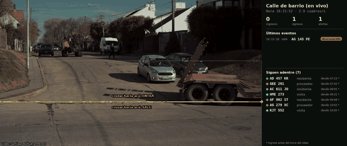
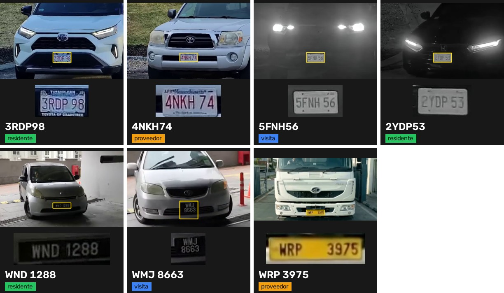

# License Plate Demo
### License plate reading and vehicle access control

A system for the gate of a gated community, a building or a plant. It reads the plate of every vehicle that arrives, checks it against the lists of residents, visitors and suppliers, and logs every entry with the time and a photo. It raises an alert the moment something does not match, and always knows who is still inside. It runs live on existing cameras, on an ordinary computer.

**Tomás González** · Individual project · November 2026

[Live mode](docs/LIVE.md) · [Evaluation](docs/EVALUATION.md) · [Data and licenses](docs/DATA.md) · [Leer en español](README.md)

**Result:** with a plate camera facing the entry lane, it logged all 5 cars in the video with the right status (resident, visitor, supplier or unknown), day and night, in all three real-time runs. On 147 Argentine plates, the reader got 140 right.

Argentine residential street, live: it reads the Mercosur plate AC 611 JO, finds it on the residents list and logs it leaving. [Full video](demo/casos/calle_argentina.mp4) · Original video: Santiago Balbuena, Pexels 38118760 (Pexels license), analysis overlay added. Lists are made up.

## How it was built

### 1. Find the plate

A plate detector looks at the barrier zone in every frame that comes from the camera. When nothing moves it does not analyse, and it always takes the newest frame, so it never falls behind what happens at the gate. Each plate gets its own ID while it is in view.

### 2. Read it many times and keep the most reliable reading

While the car approaches or waits, the plate is read in many frames. Each character is decided by a vote in which sharper, closer readings weigh more. The format is then checked (Argentine old and Mercosur, cars and motorcycles, or another country's) and typical confusions are fixed, such as an `O` read where a `0` must go. On 147 cropped Argentine plates the reader got **140 right (95.2 %)**: all 68 Mercosur plates and 72 of 79 old-format and motorcycle plates.

### 3. Check it against the lists

The plate is looked up in the lists of residents, visitors (with their allowed hours) and suppliers. The match tolerates one misread character when it is a typical confusion (`O`/`0`, `I`/`1`, `B`/`8`), so a resident is not turned away by an imperfect reading.

### 4. Log and alert instantly

Each entry is written the moment it happens, with time, plate, status and a photo of the plate. A plate that is not on the lists, could not be read, or belongs to a visitor outside their hours raises an alert. The system keeps track of who came in and has not left yet, and warns when a vehicle leaves without a logged entry.

### 5. Test it in different situations

Each video was played three times in real time on a laptop without a GPU (3 to 7 analysed frames per second), and I wrote down every plate by hand to compare:

| Situation | Result |
| --- | :---: |
| Entry with a plate camera, day and night | 5 of 5 cars with the right status in all three runs (4 of 5 plates exact: the fifth has two lines; one run added an extra alert) |
| Parking barrier, cars that stop | 2 of 2 in all three runs |
| Truck arriving at a plant gate | 1 of 1 in all three runs |
| Night entry with a low-resolution infrared camera | 4 to 6 of 6 legible plates, depending on the run |

| Case | Preview | Full video | Original video |
| --- | --- | --- | --- |
| Entry with a plate camera, day and night | [GIF](demo/casos/ingreso_dia_noche.gif) | [MP4](demo/casos/ingreso_dia_noche.mp4) | [CCTV Camera World / Avalonix, YouTube f2e7deJnfMc](https://www.youtube.com/watch?v=f2e7deJnfMc) |
| Parking barrier, day | [GIF](demo/casos/barrera_dia.gif) | [MP4](demo/casos/barrera_dia.mp4) | [YouTube oJ1sAD7IoNs](https://www.youtube.com/watch?v=oJ1sAD7IoNs), 0:48 to 1:10 |
| Truck at a plant gate | [GIF](demo/casos/camion_porton.gif) | [MP4](demo/casos/camion_porton.mp4) | [YouTube xSYAfvnfUg4](https://www.youtube.com/watch?v=xSYAfvnfUg4), first 7 s |
| Night, infrared | [GIF](demo/casos/noche_infrarrojo.gif) | [MP4](demo/casos/noche_infrarrojo.mp4) | [Lewis Surveillance, YouTube Roc4YDz6kjo](https://www.youtube.com/watch?v=Roc4YDz6kjo), 1:43 to 2:32 |

### 6. Measure it on an Argentine street

Besides the live mode, there is a version for recorded video that also tracks every vehicle, even when its plate cannot be seen. On a 58-second clip of an Argentine street filmed in 4K, with the plates written down by hand before the run, it detected all 7 vehicles that drove past, with no false ones, and gave all 7 the right status. The two plates that could not be read (a motorcycle seen from the front and a car against the light) were reported as unread, with nothing made up. Details in [EVALUATION.md](docs/EVALUATION.md).

## Conclusion

The system works end to end and in real time on an ordinary computer. What matters most is not the model but the camera: with a camera placed to read plates and a car that stops at the barrier, readings are solid; with small plates, or at night with low resolution, some are missed. In a real installation the first step is to check the camera placement and measure on its own images.

## Limits and care

- **Few test videos.** The results show that the system works; the real figure has to be measured on each site's camera.
- **A vehicle without a legible plate** does not create an event in live mode. A presence sensor at the barrier, or running the vehicle detector every few frames, covers it.
- **Personal data.** A plate that can be linked to a person is personal data (Argentina: Ley 25.326). A real installation needs a CCTV sign, short retention and restricted access. No face recognition is used.

MIT license. The plate detector weights do not state a license: confirm them or retrain before commercial use ([DATA.md](docs/DATA.md)). The Argentine street is Pexels video 38118760 by Santiago Balbuena (Pexels License).
