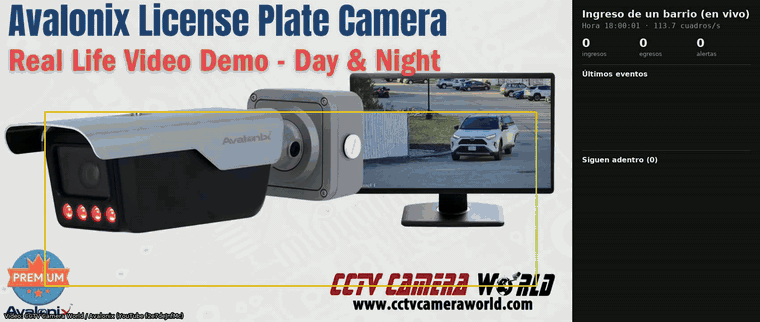
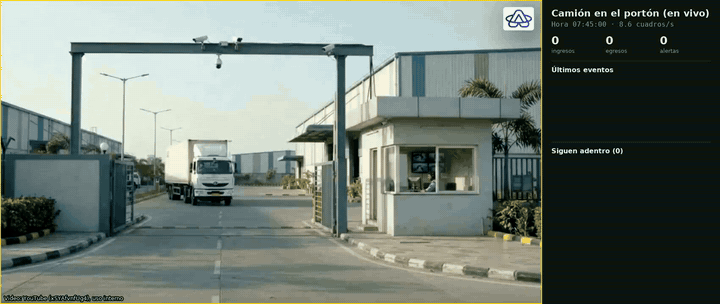
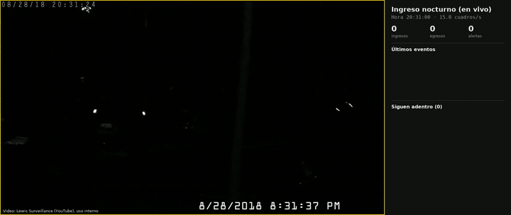

# License Plate Demo
### Lectura de patentes y control de accesos vehiculares

Un sistema para la portería de un barrio, un edificio o una planta. Lee la patente de cada vehículo que llega, la compara con las listas de residentes, visitas y proveedores, y registra cada ingreso con hora y foto. Avisa al instante si algo no corresponde y sabe en todo momento quién sigue adentro. Funciona en vivo sobre las cámaras que ya existen, con una computadora común.

**Tomás González** · Proyecto individual · noviembre de 2026

[Modo en vivo](docs/LIVE.md) · [Evaluación](docs/EVALUATION.md) · [Datos y licencias](docs/DATA.md) · [Read in English](README.en.md)

**Resultado:** con una cámara de patentes frente al carril de ingreso, registró los 5 autos del video con su estado correcto (residente, visita, proveedor o desconocido), de día y de noche, en las tres pruebas que hice en tiempo real. Sobre 147 patentes argentinas, el lector acertó 140.

Calle de barrio argentina, en vivo: lee la patente Mercosur AC 611 JO, la encuentra en la lista de residentes y registra que sale. [Video completo](demo/casos/calle_argentina.mp4) · Video original: Santiago Balbuena, Pexels 38118760 (licencia Pexels), con el análisis agregado. Listas inventadas.

## Recorrido

### 1. Encontrar la patente

Un detector de patentes revisa la zona de la barrera en cada cuadro que llega de la cámara. Si no se mueve nada, no analiza, y siempre toma el cuadro más reciente, así nunca se atrasa respecto de lo que pasa en la portería. Cada patente recibe un número propio mientras está en imagen.

### 2. Leerla varias veces y quedarse con la lectura más segura

Mientras el auto se acerca o espera, la patente se lee en muchos cuadros. Cada carácter se decide por votación, y pesan más las lecturas más nítidas y de más cerca. Después se valida el formato (argentino viejo y Mercosur, de auto y de moto, o el de otro país) y se corrigen confusiones típicas, como una `O` leída donde va un `0`. Sobre 147 patentes argentinas recortadas, el lector acertó **140 (95,2 %)**: las 68 Mercosur y 72 de 79 del formato viejo y de moto.

### 3. Compararla con las listas

La patente se busca en las listas de residentes, visitas (con su horario permitido) y proveedores. La comparación tolera un carácter mal leído, siempre que sea una confusión típica (`O`/`0`, `I`/`1`, `B`/`8`), para no dejar afuera a un residente por una lectura imperfecta.

### 4. Registrar y avisar al instante

Cada ingreso queda anotado en el momento, con hora, patente, estado y foto de la patente. Si la patente no está en las listas, no se pudo leer o es una visita fuera de su horario, sale como alerta. El sistema lleva la cuenta de quién entró y todavía no salió, y avisa si sale un vehículo que nunca registró su ingreso.

### 5. Probarlo en distintas situaciones

Cada video se pasó tres veces en tiempo real, en una notebook sin placa de video (entre 3 y 7 cuadros analizados por segundo), y anoté a mano las patentes de cada uno para comparar:

| Situación | Resultado |
| --- | :---: |
| Ingreso con cámara de patentes, de día y de noche | 5 de 5 autos con su estado correcto, en las tres pruebas (4 de 5 patentes exactas: la quinta es de dos renglones; en una prueba sumó un aviso de más) |
| Barrera de estacionamiento, autos que frenan | 2 de 2, en las tres pruebas |
| Camión llegando al portón de una planta | 1 de 1, en las tres pruebas |
| Ingreso de noche con cámara infrarroja de baja resolución | 4 a 6 de 6 patentes legibles, según la prueba |

**Ingreso con cámara de patentes, de día y de noche.** El caso más parecido a la entrada de un barrio: los autos llegan despacio frente a una cámara pensada para leer patentes.

[Video completo](demo/casos/ingreso_dia_noche.mp4) · Video original: [CCTV Camera World / Avalonix, YouTube f2e7deJnfMc](https://www.youtube.com/watch?v=f2e7deJnfMc), con el análisis agregado. Patentes de Estados Unidos; nombres y listas inventados.

**Barrera de día.** Dos autos frenan frente a la barrera: uno es residente y el otro, una visita autorizada en su horario.

[Video completo](demo/casos/barrera_dia.mp4) · Video original: [YouTube oJ1sAD7IoNs](https://www.youtube.com/watch?v=oJ1sAD7IoNs) (0:48 a 1:10), con el análisis agregado. Patentes de Malasia.

**Camión en el portón de una planta.** Espera a tener una lectura firme y lo registra como proveedor con turno.

[Video completo](demo/casos/camion_porton.mp4) · Video original: [YouTube xSYAfvnfUg4](https://www.youtube.com/watch?v=xSYAfvnfUg4) (primeros 7 segundos), con el análisis agregado.

**Ingreso de noche con infrarrojo.** El caso más difícil: video de baja resolución y patentes encandiladas por la luz infrarroja. Una visita que llega fuera de su horario sale como alerta.

[Video completo](demo/casos/noche_infrarrojo.mp4) · Video original: [Lewis Surveillance, YouTube Roc4YDz6kjo](https://www.youtube.com/watch?v=Roc4YDz6kjo) (1:43 a 2:32), con el análisis agregado. Patentes de Estados Unidos.

### 6. Medirlo con una calle argentina

Además del modo en vivo, el sistema tiene una versión para video grabado que también sigue a cada vehículo, aunque no se le vea la patente. En un video de 58 segundos de una calle argentina filmada en 4K, anoté las patentes a mano antes de correrlo: detectó los 7 vehículos que pasaron, sin falsos, y asignó bien el estado de los 7. Las dos patentes que no se podían leer (una moto de frente y un auto a contraluz) quedaron como "no leída", sin inventar nada. El detalle está en [EVALUATION.md](docs/EVALUATION.md).

## Conclusión

El sistema funciona de punta a punta y en tiempo real en una computadora común. Lo que más pesa en el resultado no es el modelo sino la cámara: con una cámara ubicada para leer patentes y un auto que frena en la barrera, las lecturas son firmes; con patentes chicas, o de noche con poca resolución, aparecen pérdidas. Por eso, en una instalación real, lo primero es revisar la ubicación de la cámara y medir con sus propias imágenes.

## Límites y cuidados

- **Pocos videos de prueba.** Los resultados muestran que el sistema funciona, pero el número real hay que medirlo con la cámara de cada lugar.
- **Un vehículo sin patente legible** no genera evento en el modo en vivo. Un sensor de presencia en la barrera o el detector de vehículos cada tantos cuadros lo cubren.
- **Datos personales.** Una patente asociable a una persona es un dato personal (Ley 25.326). Una instalación real necesita cartel de zona videovigilada, retención corta de los registros y acceso restringido. No usa reconocimiento facial.

Licencia MIT. Los pesos del detector de patentes no declaran licencia: hay que confirmarlos o reentrenarlos antes de un uso comercial ([DATA.md](docs/DATA.md)). La calle argentina es el video 38118760 de Santiago Balbuena en Pexels (licencia Pexels).
